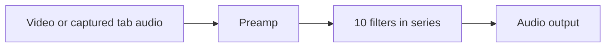

# Multiband equalizer feasibility

Research date: 2026-10-22. Status: documentation research and proposed design only. No EQ implementation, live YouTube audio experiment or browser compatibility certification was performed.

## Conclusion

**A multiband EQ is technically feasible through the browser's Web Audio API.** The documented [YouTube IFrame Player API](https://developers.google.com/youtube/iframe_api_reference#Playback_controls) provides volume and mute controls, but no equalizer or access to decoded audio samples. It also targets embedded players rather than an extension controlling the existing watch page. No YouTube API key or backend is needed for local audio filtering.

The unresolved feasibility question is obtaining a reliable audio source from actual YouTube playback without breaking sound. Recommend a small, opt-in audio-routing prototype before building the panel. This extends the [earlier API report](youtube-player-api-and-feature-opportunities.md#3-other-apis-worth-exposing-through-features); the source-routing risk identified there remains open.

## Frequencies and band controls

The API does not prescribe a list of EQ bands. `BiquadFilterNode.frequency` accepts frequency values in hertz, with a nominal range from 0 to half the audio context's sample rate (the Nyquist frequency). Thus 44,100 Hz gives a 22,050 Hz upper bound and 48,000 Hz gives 24,000 Hz. These are computed examples, not a claim about YouTube's current stream sample rate. Read `context.sampleRate` and the parameter limits at runtime. Keep useful filter centers strictly inside those bounds. See the [frequency reference](https://developer.mozilla.org/en-US/docs/Web/API/BiquadFilterNode/frequency).

Suggested product choices, not API requirements:

| Option     | Band centers in Hz                                                       | Intended use                                |
| ---------- | ------------------------------------------------------------------------ | ------------------------------------------- |
| 5 bands    | 60, 250, 1000, 4000, 12000                                               | Simpler interface                           |
| 10 bands   | 31.25, 62.5, 125, 250, 500, 1000, 2000, 4000, 8000, 16000                | Recommended initial full EQ                 |
| Parametric | User-selectable centers, for example 20–20000, bounded by runtime limits | Advanced frequency, width and gain controls |

A 10-band panel could label its first bands 31 and 63 Hz while retaining 31.25 and 62.5 internally. Proposed gain range: -12 to +12 dB per band, 0 dB initially. This is a deliberate UI limit, not the API's maximum.

Use `peaking` filters for independent boost/cut around each center. `Q` controls bandwidth: larger Q means a narrower band. `lowshelf` and `highshelf` are alternatives for the low/high ends; their Q parameter is not used. Do not chain `bandpass` filters as though they were EQ sliders: each removes frequencies outside its passband. See [BiquadFilterNode types and parameters](https://developer.mozilla.org/en-US/docs/Web/API/BiquadFilterNode).

Proposed starting point: Q around 1.4 for octave-spaced peaking bands, then inspect the combined response and tune it. This is an engineering starting point, not a guaranteed graphic-EQ response. Cascaded filters overlap; slider gain does not imply the same gain across a sharply separated frequency bucket. An EQ also cannot restore content absent from the source recording or codec.

## Processing graph

Both acquisition approaches below feed this same graph. Native biquad nodes are sufficient for a conventional EQ; a custom AudioWorklet is unnecessary for the first prototype.

Proposed control behavior:

- Create the graph only after the user enables EQ. Provide Flat, Reset and Bypass.
- Smooth gain changes over a short interval, for example a 10–30 ms time constant, using [AudioParam.setTargetAtTime](https://developer.mozilla.org/en-US/docs/Web/API/AudioParam/setTargetAtTime), to avoid abrupt slider changes.
- Add a preamp and reserve headroom when boosting. For initial measurements, attenuate conservatively; do not assume that subtracting only the largest slider boost prevents clipping when filters overlap. Calculate the combined response or use metering to refine headroom. A compressor can change dynamics and is not a guaranteed transparent true-peak limiter.
- Save band gains, Q where configurable, preamp and the preferred enabled state. Store actual routing/capture status separately: a saved preference does not prove audio is being processed.

## Approach A: use the existing video element

`AudioContext.createMediaElementSource(video)` routes the element through Web Audio. Playback controls remain on the original element; avoid creating a second player. See [createMediaElementSource](https://developer.mozilla.org/en-US/docs/Web/API/AudioContext/createMediaElementSource).

Important constraints from the [Web Audio specification](https://webaudio.github.io/web-audio-api/#MediaElementAudioSourceNode):

- A media-element source must output silence for media classified as CORS-cross-origin. Extension host permissions do not by themselves change that media classification. A `blob:` URL alone is insufficient evidence of usable audio; test actual playback and source changes.
- The same element cannot be repeatedly associated with new media-element source nodes. Keep one owned source and reuse its graph. Another extension or page script may already own a source.
- Creating the source changes routing. Disconnecting nodes or closing the context must not be treated as restoring native output. For bypass, preserve a working audible path; verify failure recovery before adopting this route.

Do not change `video.crossOrigin` or reload its source as a speculative fix: this can interfere with YouTube's playback pipeline. Establish ownership and recovery in the prototype first. Changing to page-world execution is not a CORS bypass.

## Approach B: capture tab audio

[Chrome tabCapture](https://developer.chrome.com/docs/extensions/reference/api/tabCapture) provides a tab audio stream that can feed `createMediaStreamSource`. This is a candidate when direct media-element routing is unusable; it is not proof that every YouTube content type can be processed.

Constraints:

- Requires `tabCapture` permission and a qualifying user invocation of the extension, such as its browser action. Do not assume a click in our injected YouTube toolbar grants that invocation.
- Capture suppresses the tab's normal local playback. Connect the processed stream to the audio destination immediately and handle failures to avoid silence.
- Captures tab audio, potentially including ads and other sounds, rather than just the selected video.
- From Chrome 116, a stream ID obtained in the service worker can be consumed by an offscreen document. IDs are single-use and short-lived.

For Manifest V3, the [official capture guide](https://developer.chrome.com/docs/extensions/how-to/web-platform/screen-capture#record-audio-and-video-in-the-background) demonstrates service worker → stream ID → offscreen document → `getUserMedia`. Keep the audio graph in that document rather than the worker. This is live processing; no recording or upload is required for EQ.

Add the `offscreen` permission if using this architecture. Choose an accurate creation reason such as `USER_MEDIA` for stream consumption; account for the 30-second silent timeout if using `AUDIO_PLAYBACK`. Only one offscreen document per extension/profile is supported, so multiple tab sessions need coordination. See [offscreen API](https://developer.chrome.com/docs/extensions/reference/api/offscreen).

## Integration and possible blockers

Current code has a video selector/lifecycle in `src/platform/youtube/player.ts`, narrow contracts in `src/core/contracts.ts`, and only `storage` and `downloads` permissions in `wxt.config.ts`. The existing worker handles screenshots. An EQ needs a separate audio adapter and explicit ownership, not scattered source creation inside slider handlers.

| Area                      | Required investigation before shipping                                                                                                                                                                                                                              |
| ------------------------- | ------------------------------------------------------------------------------------------------------------------------------------------------------------------------------------------------------------------------------------------------------------------- |
| Audio startup             | Resume suspended contexts from an appropriate interaction; expose processing errors. [Chrome autoplay policy](https://developer.chrome.com/blog/autoplay/#web-audio) applies to Web Audio.                                                                          |
| Navigation and ads        | Exercise SPA navigation, element replacement, ads, live streams, seeking, native speed, audio-track changes and repeated enable/disable. Avoid duplicate graphs, silence and doubled playback.                                                                      |
| Layouts and modes         | Check normal and experimental layouts, fullscreen and our mini player; test native PiP separately. Treat remote casting as unverified and potentially outside the local graph.                                                                                      |
| Latency and CPU           | Measure listening delay, lip sync, CPU and battery. [AudioContext.baseLatency](https://developer.mozilla.org/en-US/docs/Web/API/AudioContext/baseLatency) describes only part of output delay, not end-to-end tab-capture latency. Bluetooth adds another variable. |
| Permissions and lifecycle | Test rejected capture, ended tracks, tab close, extension reload/disable, worker restart and multiple YouTube tabs. Define restoration and cleanup for each route.                                                                                                  |
| Restricted media          | Test protected/purchased content separately; do not promise it works or attempt to bypass restrictions.                                                                                                                                                             |
| Compatibility             | Verify in the actual target Brave version. Chrome documentation describes the Chromium approach; it does not certify Brave or establish Firefox support.                                                                                                            |

## Recommended next step and acceptance gate

Do not implement EQ as part of this research. When selected for development:

1. Try direct element routing in a disposable test session and verify audible output, bypass and failure recovery. Do not enable it automatically on ordinary watch tabs.
2. If unsuitable, prototype tab capture with an explicit browser-action entry point and an offscreen audio graph. Confirm whether that extra activation step is acceptable for the product.
3. Validate flat response and known boosts/cuts with test tones or an offline audio fixture; inspect the combined filter response. Confirm stereo preservation and measure clipping and delay on real playback.
4. Run the lifecycle matrix above. Only after a route passes, build the 10-band UI, presets and saved settings.

**Decision:** the EQ processing itself is supported; reliable YouTube audio acquisition and restoration remain unverified. Prefer the simpler direct route only if it passes the live spike. Otherwise evaluate tab capture and its activation/permission cost before committing to the feature.
